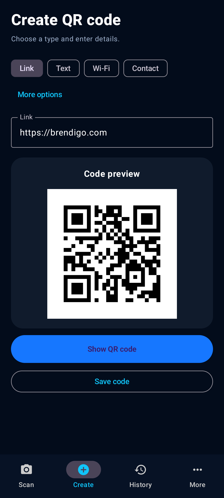

<div align="center">


### Scan. Create. Share.

**Private, fast and simple QR scanning for Android.**

[**Get QREX for Android**](https://github.com/bren-wp/QREX/releases) · [Features](#features) · [Privacy](#privacy-first)


**No account · No ads · No tracking · Offline QR scanning and creation**

</div>

---

## Android-only application

QREX is developed exclusively for **Android** with **Kotlin, Jetpack Compose, CameraX, on-device ML Kit and ZXing**. The discontinued iOS and Flutter application sources, tests and signing pipelines are no longer part of the active project. The natively implemented **Flutter-to-Android migration** stays in place to protect data belonging to users of the earlier Android release.



This is an actual Android emulator capture, not a design mockup. Matching the approved design 1:1 on all phones still requires direct comparisons across several physical devices.

## Features

- **Scan:** QR codes from a live camera or selected photo using on-device detection.
- **Create:** QR codes for URLs, text, Wi-Fi, email, phone, coordinates and contacts.
- **Review:** URLs never open automatically. You choose when to copy, open or share a result.
- **Save:** Favorites and local history, with search, removal and full data deletion.
- **Secure:** Manually saved Wi-Fi QR data is protected by Android Keystore AES-GCM and is not recorded automatically. Copying marks sensitive clipboard data; sharing requests explicit confirmation.
- **Export:** On-device PNG, printable PDF and ZIP exports, using system file picker. Files exported by you are **not encrypted**.
- **Accessible:** Adaptive QR previews, compact phone layouts, light/dark modes, **23 interface languages** including Croatian and English.

## Privacy-first

QR scanning and code creation work locally. QREX requires no registration, backend, ads, analytics or tracking. Camera access is requested only when you tap to enable the camera; gallery picking remains available without CAMERA permission. Android backup is disabled, internet/contacts/location/storage permissions are not requested, and scanned links require an explicit user action to open.

Read the [Privacy Policy](docs/PRIVACY.md) and [Terms of Use](docs/TERMS.md).

## Android build and verification

The source of truth is `platforms/android/`. Use JDK 17 and Android SDK API 36:

```bash
python3 tool/generate_localizations.py --check
python3 -m unittest discover -s tool -p 'test_*.py'
cd platforms/android
gradle :app:assembleDebug :app:testDebugUnitTest :app:lintDebug
```

An emulator run also executes instrumented tests and captures the real Create UI. Android CI additionally checks release R8/resource shrinking and bundle generation. Debug builds and unsigned QA artifacts are **not** production distributions.

## Distribution

The next production version is **QREX 1.0.0 / build 100**, published only after explicit device QA, Play Console checks and verified signing with the existing Android upload identity. A future `v1.0.0` release contains the **signed Android AAB** and `SHA256SUMS.txt`. An AAB is a Play Console upload package, not a directly installable APK.

Earlier Flutter Android and native preview releases stay available until that signed replacement has genuinely been published. The production workflow then retires old GitHub Releases and tag refs; it never publishes an unsigned build just to make the repository look finished.

[All releases](https://github.com/bren-wp/QREX/releases) · [Production checklist](docs/STORE_CHECKLIST.md) · [Release notes](docs/releases/v1.0.0.md) · [Support](https://brendigo.com)

---

<div align="center">


Made by [Brendigo](https://brendigo.com) · [MIT License](LICENSE)

</div>
