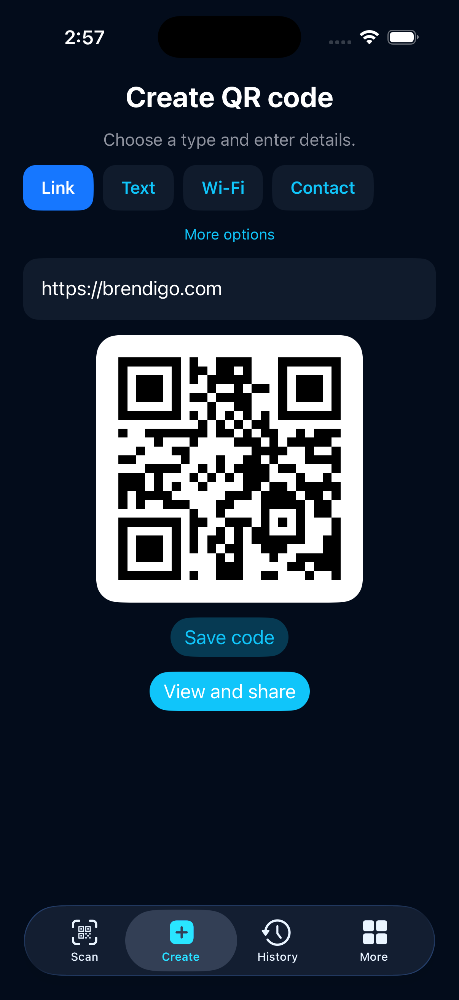

### Scan. Create. Share.

**All the QR essentials. Beautifully simple.**

Scan what matters, turn everyday information into a QR code, and keep the things you choose — in one clear, private, multilingual experience.

 

[**Get QREX for Android**](https://github.com/bren-wp/Qivio/releases/latest) · [Explore features](#everything-you-need-nothing-you-dont) · [Privacy promise](#made-for-your-privacy)

 

**No account · No ads · No tracking · Offline QR scanning and creation**

---

## A clearer way to QR

Whether you're scanning a code from the camera, sharing your Wi-Fi details, or making a new code for a link, QREX keeps each action straightforward.

<table>
<tr>
<td align="center" width="50%">

<strong>QREX on Android</strong>

</td>
<td align="center" width="50%">

<strong>QREX on iPhone</strong>

</td>
</tr>
</table>

Actual application screens captured during Android emulator and iPhone simulator sessions. Appearance may vary with device, display size and software version. These are not generated concept images.

## Everything you need. Nothing you don't.

| | |
|---|---|
| **📷 Scan with ease** | Read QR codes with your camera or select a picture from your gallery. |
| **✨ Make your own** | Create QR codes for websites, text, Wi-Fi, email, phone numbers, locations and contacts. |
| **🛡️ Stay in control** | Preview a destination before opening it. Sharing and export happen only when you choose. |
| **🔖 Keep the useful ones** | Save favorite codes, search local history and clear your information. |
| **🎨 Make it yours** | Choose light or dark appearance and a language that feels familiar. |
| **📱 Share anywhere** | Copy results, send a code or export its QR artwork with the system share options. |
| **📄 Keep a beautiful record** | Save your favorite QR codes as printable PDF documents packed into one ZIP archive in the upcoming Android and iPhone editions. |

## Designed for everyday moments

**At home.** Share a network with a guest without reading out a complicated Wi-Fi password.

**At work.** Turn a website, telephone number or contact into a code that's easy to share.

**On the move.** Scan a printed code, check its destination and save what you need for later.

## Speak your language

QREX includes **23 interface languages**, with English as the default:

English · Hrvatski · Deutsch · Français · Español · Italiano · Português · Nederlands · Polski · Čeština · Slovenčina · Slovenščina · Magyar · Română · Български · Ελληνικά · Türkçe · Українська · Русский · Svenska · Dansk · Suomi · Norsk bokmål.

Switch languages directly in **Settings**. English is the first-launch default, and Croatian is fully available alongside 21 more languages. No account or connection required.

## Made for your privacy

Your everyday QR experience shouldn't require handing over personal information.

- **No registration** — open QREX and start using it.
- **No ad interruptions or analytics trackers** — your attention stays on what you're doing.
- **On-device QR reading and generation** — you don't need a QREX cloud account.
- **You choose what to keep** — saved QR codes and history are under your control.
- **You decide what to open or share** — scanning a link never automatically opens it.

The current public Android edition and the upcoming dedicated Android/iOS editions have different storage implementations. In the newer editions, manually saved Wi-Fi QR credentials are protected using Android Keystore or the iOS Keychain. Please consult the [privacy policy](docs/PRIVACY.md) for the edition you install.

## Get QREX

### Android

**[Download the latest public Android APK →](https://github.com/bren-wp/Qivio/releases/latest)**

Latest published edition: **v0.1.3**. See the release page for its verified APK and checksum.

### iPhone & iPad

A dedicated iOS edition is in validation and is **not yet publicly available on the App Store**.

 

[All releases](https://github.com/bren-wp/Qivio/releases) · [Privacy Policy](docs/PRIVACY.md) · [Terms of Use](docs/TERMS.md) · [Support](https://brendigo.com)

---

**Scan. Create. Share.**

Made by [Brendigo](https://brendigo.com) · © QREX contributors · [MIT License](LICENSE)

