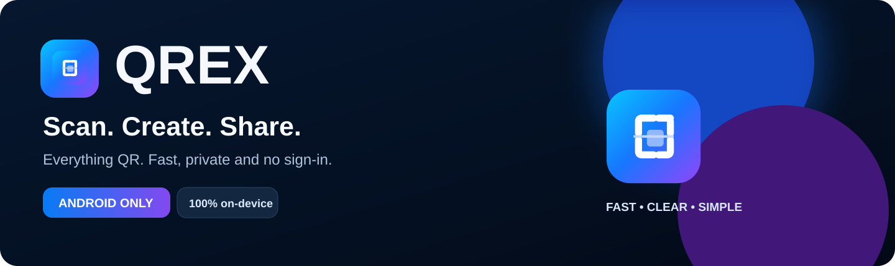
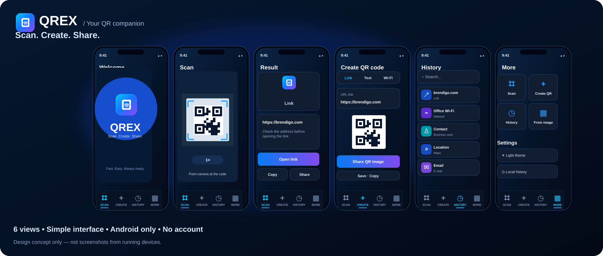

<div align="center">


### Scan. Create. Share.

**Your QR codes. Your device. Your choice.**

A clean, capable QR scanner and creator designed exclusively for **Android**.

[Explore features](#features) · [See the app](#preview) · [Privacy](#privacy-by-design) · [Releases](https://github.com/bren-wp/QREX/releases)


**Free to use · No accounts · No ads · No tracking**

</div>

---

## A simple way to do more with QR

Scan a code, create one of your own, or keep the information you actually need. QREX makes common tasks easy without moving your personal QR content to a QREX server.



## Preview

<div align="center">


<sub>Actual Android emulator capture, verified by CI. Device appearance and layout can vary. Brand visuals below are design illustrations, not app screenshots.</sub>



</div>

## Features

| | What QREX does |
|:--|:--|
| 📷 **Scan** | Read QR codes with the camera or choose a photo from your gallery. |
| ✨ **Create** | Make QR codes for links, text, Wi-Fi access, contacts, email, phone numbers and locations. |
| 🔗 **Review before opening** | Check the scanned destination before deciding whether to open it. |
| 🔖 **History & favorites** | Keep, find and delete locally stored codes on your own terms. |
| 🛡️ **Private Wi-Fi codes** | Encrypt manually saved Wi-Fi QR contents using Android Keystore; ask before sharing Wi-Fi QR credentials. |
| 📄 **Export** | Export QR images as PNG and manually saved QR codes as PDF or ZIP using Android's file picker. |
| 🌐 **23 languages** | Choose English, Croatian or another supported interface language. |
| 🌗 **Comfortable UI** | Light/dark appearance and layouts designed to adapt to different Android display sizes. |

## Privacy by design

QREX scans and generates codes locally. **No account, advertising SDK, analytics SDK, or internet permission is required.** Camera permission is requested only when you choose to enable live camera scanning. Gallery selection uses Android's system photo picker instead of broad media access.

Wi-Fi QR codes are not added to history automatically. If you explicitly save one, its contents are protected using AES-GCM with Android Keystore. When copying a Wi-Fi QR code, Android receives a *sensitive clipboard* flag; sharing a Wi-Fi code asks for confirmation.

**Important:** exported PDF/ZIP files are *not encrypted*. Treat exports that contain private information or Wi-Fi credentials as sensitive. The destination app or file provider you select may keep copies.

[Read the Privacy Policy](docs/PRIVACY.md) · [Terms of Use](docs/TERMS.md)

## Languages

QREX includes 23 offline interface languages:

English · Hrvatski · Deutsch · Français · Español · Italiano · Português · Nederlands · Polski · Čeština · Slovenčina · Slovenščina · Magyar · Română · Български · Ελληνικά · Türkçe · Українська · Русский · Svenska · Dansk · Suomi · Norsk bokmål.

No download or online translation service is needed to switch languages.

## Built for Android

| | |
|:--|:--|
| **Platform** | Android only |
| **Application ID** | `com.brendigo.qrex` |
| **UI** | Kotlin + Jetpack Compose |
| **Scanning** | CameraX + on-device ML Kit |
| **QR generation** | ZXing |
| **Private storage** | Android Keystore / AES-GCM |
| **Android SDK** | Compile/target API 36 |
| **Latest GitHub release** | Version `1.0.2` · versionCode `102` (not a Play release) |

The former iOS and Flutter app source trees have been retired. The Android application **retains migration support** for users upgrading from the earlier Flutter-based Android version.

### Build from source

Requirements: JDK 17, Android SDK API 36 and Gradle 8.13.

```bash
python3 tool/generate_localizations.py --check
python3 tool/check_translation_usage.py
python3 -m unittest discover -s tool -p 'test_*.py'

cd platforms/android
gradle --no-daemon :app:assembleDebug :app:testDebugUnitTest :app:lintDebug
```

GitHub Actions also exercises Android instrumentation tests, minified release build/AAB generation and a genuine Android emulator screenshot.

## Download QREX 1.0.2 for Android

[**GitHub Releases — APK, AAB and checksums →**](https://github.com/bren-wp/QREX/releases)

| File | Purpose |
| --- | --- |
| **`QREX-Android-1.0.2.apk`** | Installable Android APK built in release mode |
| **`QREX-Android-1.0.2.aab`** | Android App Bundle; not directly installable |
| **`SHA256SUMS.txt`** | Checksums for validating the downloaded packages |

The v1.0.2 GitHub build does **not require your Google Play signing credentials**. Android requires APK signing for installation, so this build uses a temporary GitHub-generated certificate instead of your production Play identity. **It is not Google Play ready**, and its APK cannot update any existing QREX installation signed with another certificate. Uninstalling the previous version may delete saved QR codes. Preserve your data before switching installations.

The earlier [v1.0.0](https://github.com/bren-wp/QREX/releases/tag/v1.0.0) and [v1.0.1](https://github.com/bren-wp/QREX/releases/tag/v1.0.1) downloads are preserved. **Every published GitHub APK uses a separate disposable certificate**: v1.0.2 cannot be installed in place over those versions or an existing Play-signed installation. Do not uninstall a previous app before safely exporting its local records. Saved data and Android Keystore keys may be irreversibly lost on uninstall.

The existing manual Google Play 1.0.1 upload workflow is **separate**; a future Play v1.0.2 must use the approved upload identity and verified available versionCode. This GitHub AAB is **not** an eligible Play update. See the [Google Play guide](docs/PLAY_STORE_SUBMISSION.md).

Automated GitHub publication is permitted only after the exact Android commit passes Kotlin tests/build, emulator screenshot and language validation. [QREX 1.0.2 release notes](docs/releases/v1.0.2.md) · [Official v1.0.2 download](https://github.com/bren-wp/QREX/releases/tag/v1.0.2).

[All releases](https://github.com/bren-wp/QREX/releases) · [Android QA checklist](docs/STORE_CHECKLIST.md) · [Support](https://brendigo.com)

---

<div align="center">


**Scan. Create. Share.**

Created by [Brendigo](https://brendigo.com) · [Support](https://brendigo.com) · [MIT License](LICENSE)

</div>
