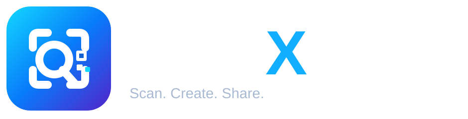
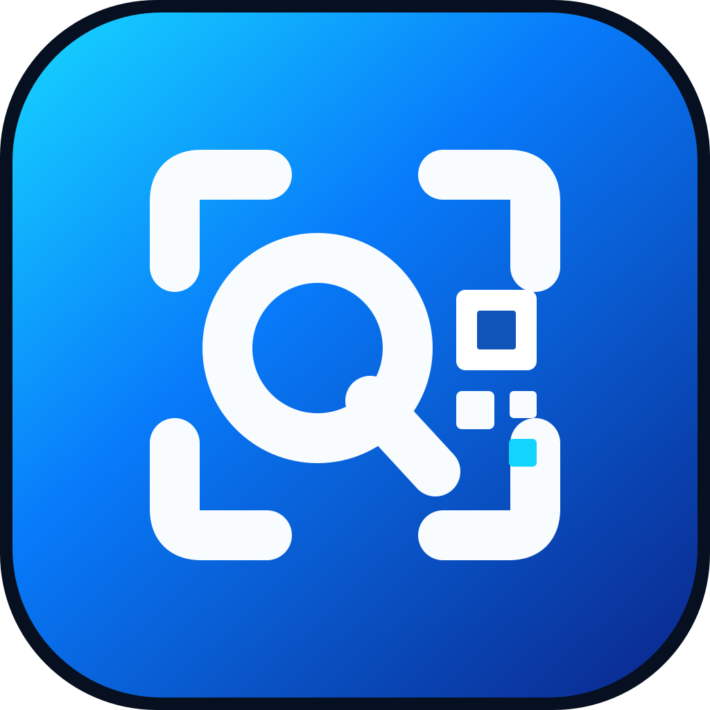

# Scan. Create. Share.

### Your everyday QR code and document scanner — in one beautifully simple app.

**Scan QR codes. Capture documents. Create PDFs. All from your phone.**

📷 **QR & document scanning** &nbsp; · &nbsp; ✨ **Smart editing** &nbsp; · &nbsp; 🔒 **Privacy first**

**Free · Offline · No ads · No account required**

[Explore QREX](#everything-you-need) · [View screenshots](#see-qrex-in-action) · [Download](#get-qrex)

---

## One app. More possibilities.

Whether you're sharing a link, connecting to Wi-Fi or turning paper into a clear PDF, QREX keeps the entire experience fast and easy. No sign-ups, unnecessary steps or cluttered screens.

| 📱 Scan & create QR codes | 📄 Scan & edit documents | 🔐 Keep control |
|:--|:--|:--|
| Read codes instantly, create your own and keep favorites close. | Capture paper, adjust the suggested crop immediately, then save to PDF. | Work locally, choose what to save and share files only when you decide. |

## Everything you need

### 📷 QR Scanner & Creator

Point the camera at a code or pick an image from your gallery. QREX makes it simple to review the result, copy or share it, save favorites, and create your own codes for links, Wi-Fi, text, contact details, events and more.

- **Instant QR scanning** — live camera and gallery import
- **Quick QR creation** — useful code types for everyday sharing
- **Saved codes and history** — the important things stay within reach
- **Thoughtful safety** — review links before opening them

### 📄 Document Scanner & PDF Studio

Turn your phone into a practical pocket document scanner. Capture a receipt, a letter or multiple pages, then make every page look clean and easy to read — using the familiar QREX interface.

- **Capture or import** — photograph documents, choose an image or open an existing PDF
- **Immediate crop** — open the crop editor automatically after each photo or image import; adjust suggested page edges by hand
- **Perspective correction** — straighten paper captured at an angle
- **Improve readability** — Auto enhance, grayscale and black-and-white filters
- **Organize pages** — rotate, reorder, edit or remove pages; combine up to eight
- **Export & share** — make a multipage PDF or save individual pages as PNG

No separate document app to learn. Tap the prominent **Document scan** button on **Scan**; each new page goes straight to cropping and then Pages.

### 🌙 Designed to feel right

Enjoy a consistent and accessible **dark-only** interface, with fewer steps between capturing, cropping and PDF export. QREX is available in **23 languages**.

## See QREX in action

These are screenshots of the actual QREX Android interface.

<table>
<tr>
<td align="center">
<strong>Scan instantly</strong>
</td>
<td align="center">
<strong>Create your QR</strong>
</td>
<td align="center">
<strong>Smart results</strong>
</td>
<td align="center">
<strong>Your scans</strong>
</td>
</tr>
<tr>
<td align="center">
<strong>Favorites</strong>
</td>
<td align="center">
<strong>Wi-Fi codes</strong>
</td>
<td align="center">
<strong>More tools</strong>
</td>
<td align="center">
<strong>Export</strong>
</td>
</tr>
<tr>
<td align="center">
<strong>Languages</strong>
</td>
<td align="center">
<strong>About QREX</strong>
</td>
<td align="center">
<strong>Privacy</strong>
</td>
<td align="center">
<strong>QREX launch</strong>
</td>
</tr>
</table>

### Document scanning, your way

From immediate precision cropping to document organization and PDF export.

<table>
<tr>
<td align="center">
<strong>Review · Dark</strong>
</td>
<td align="center">
<strong>Crop · Dark</strong>
</td>
<td align="center">
<strong>Pages · Dark</strong>
</td>
<td align="center">
<strong>Export · Dark</strong>
</td>
</tr>
</table>

Screens shown are from the published QREX release. Discover the latest app screens and downloads in [GitHub Releases](https://github.com/bren-wp/QREX/releases).

## Privacy comes first

Your QR scans and document edits are processed on your device. QREX does not require an account or add advertisements. You choose when to save, export or share.

- **Offline by design** — scanning and document editing don't require a cloud service.
- **In your hands** — control what stays in history and what gets exported.
- **Share intentionally** — export files only to a destination you select.

PDF files you export are not automatically encrypted. Keep sensitive documents in a trusted location.

## Get QREX

Download QREX for Android or explore the latest published GitHub release.

Latest published release: **[v1.0.53](https://github.com/bren-wp/QREX/releases/tag/v1.0.53)**

[**Download QREX for Android**](https://github.com/bren-wp/QREX/releases/tag/v1.0.53) · [All releases](https://github.com/bren-wp/QREX/releases)

### A few good things to know

QREX works on **Android 8.0 and newer**. The public GitHub app downloads use a different signing identity from Google Play, so a GitHub download cannot replace an existing Google Play installation in place. Before changing installation channels, preserve anything important from your saved data.

For details, visit the [Privacy Policy](docs/PRIVACY.md) or [Help & Support](https://brendigo.com).

---

**QREX by [Brendigo](https://brendigo.com)**

*Scan. Create. Share.*

Latest published version: QREX v1.0.53 · Last complete screenshot release: v1.0.53 · Current release: v1.0.53 (published).

